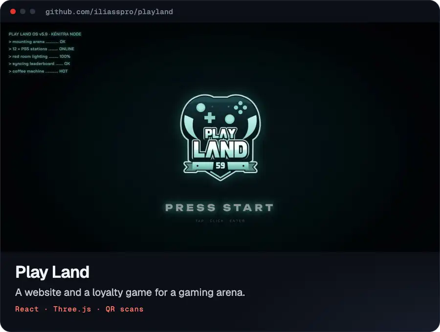

# Play Land: website + Play Pass ecosystem

A gaming-themed website for **Play Land** (PS5 arena) plus a full loyalty ecosystem prototype: QR check-ins, XP and coins, 59 levels and 7 ranks, quests, achievements, a rewards shop, a season pass, leaderboards and squads, live station map, tournaments, arcade mini-games and a staff console.



Everything runs in the browser with **mock data** (saved in `localStorage`). No backend, no login.

## Run it

```bash
npm install
npm run dev
```

Open <http://localhost:5173>.

**Test with a real phone:** connect the phone to the same Wi-Fi and open the `Network` URL Vite prints (e.g. `http://192.168.x.x:5173`). The QR posters in the staff console automatically encode that address, so you can scan them with the phone's normal camera app. The scan link opens the Play Pass on the phone, which asks you to create a player and then applies the scan.

> The in-page camera scanner needs HTTPS (or `localhost`). Over plain LAN http, use the phone's camera app. It does the same thing.

## Tour

| Route | What it is |
|---|---|
| `/` | Website: boot intro (PRESS START), 3D hero (extruded crest, neon controller shapes, spinning coins, bloom), rooms, Play Pass story, rank ladder, loot, live leaderboard, tournaments, live stations, game modes, gallery, radar location map |
| `/join` | Create a player: gamertag, 8-bit avatar, main game, squad; +500 welcome coins |
| `/hub` | Player dashboard: holographic Play Pass card, level, check-in status, daily quests, streak, arcade, next event, weekly rank, activity |
| `/scan` | QR scanner: real camera scanning (jsQR), deep links (`/scan?code=…`), demo codes and an animated loot receipt |
| `/quests` | Daily, weekly and season quests + 20 achievements |
| `/rewards` | Rewards shop → voucher QR shown at the counter |
| `/season` | Season 01 "Red Room": 30-tier free + Elite track |
| `/ranks` | Weekly, monthly and all-time boards, squads, Hall of Fame |
| `/events` | Tournaments with a live bracket, sign-ups, event check-ins |
| `/map` | Live floor plan of the arena: station status, reservations, rush forecast |
| `/arcade` | Lucky Spin (daily), Penalty King (5 shots/day), weekend Pronos |
| `/profile` | Card flip (friend QR), stats, cosmetics, settings, history |
| `/staff` | Game Master console: rotating entrance QR, KPIs, charts, voucher desk, live feed, crew bonus, printable QR posters + secret-hunt codes |

### Demo tips

- On `/hub`, click **Load demo player** for *NeonNoor*: Level 23 Pro, 6-week streak, and 90 XP short of level 24, so the first entrance scan levels up.
- The **Demo** button (bottom-right in the hub) simulates scans (entrance, station, VIP, coffee, secret, friend), grants XP/coins, settles predictions, wins the cup, and **skips to tomorrow** so the daily limits reset.
- Sounds are synthesized live (no audio files). Toggle them in the top bar.

## The economy

| Action | XP | Coins |
|---|---|---|
| Daily check-in (entrance QR) | 100 | 50 |
| 1 hour on a station (station QR) | 60 | 30 |
| Coffee (max 3/day) | 15 | 10 |
| Event check-in | 200 | 100 |
| Secret QR (5 hidden in the arena) | 250 | 150 |
| Playing with a friend | 150 | 100 |

- **Double XP** Mon–Thu 14:00–18:00, which fills the emptiest hours (see the staff heatmap).
- **Weekly visit streak** multiplies coins: ×1.1 at 2 weeks, ×1.25 at 4, ×1.5 at 8.
- **Ranks** add a permanent coin bonus: Rookie → Challenger (+5%) → Pro (+10%) → Elite (+15%) → Master (+20%) → Grandmaster (+25%) → **Club 59** (+30%, max level 59, the number on the crest).
- **1 free hour = 900 coins**, which works out to roughly one free hour every 6 visits.

## Brand notes

- Colors are sampled from the official crest and the venue: ink black, crest mint `#8AD0C7`, red-room crimson, white.
- The crest is rebuilt as an animated vector (`src/components/brand/Crest.tsx`). Swap in the official vector file if you have one.
- Photos in `public/media` come from the public Google Maps listing and are **placeholders**. Replace them with photos the business owns.
- Address, phone, Instagram and the 02:00 closing time come from the Google listing. **Prices, the 10:00 opening time and all stats are placeholders.**

## Taking it to production

The UI is ready; these parts need a backend:

1. **Accounts:** phone number + WhatsApp/SMS code, no passwords.
2. **Server-side scan validation:** signed rotating entrance codes (HMAC per 30-second slot), one check-in per day, and session codes printed on the receipt by staff instead of static station QRs.
3. **Vouchers:** issued and redeemed server-side, single-use, with staff authentication.
4. **Real analytics** for the staff console, built from scan events.
5. **Notifications:** "your station is free", "your streak ends Sunday", tournament reminders.
6. **Apple Wallet / Google Wallet** pass for the Play Pass card.
7. **French and Arabic (RTL)** versions.

## Stack

Vite · React 19 · TypeScript · Motion · Three.js / React Three Fiber (hero only, lazy-loaded) · Zustand (persisted state) · jsQR + qrcode · Lenis · canvas-confetti · Lucide.

```
src/
  components/brand   crest + wordmark (vector, animated)
  components/fx      boot screen, page wipe, cursor, celebration layer (coins, level-up, achievements)
  components/three   3D hero scene
  components/ui      buttons, tilt cards, avatars, rank emblems, QR renderer, Play Pass card
  data/              mock data: ranks, quests, achievements, rewards, events, stations, players…
  lib/               sound synth, QR encode/decode, time, rng
  store/             player state + game rules
  pages/             landing, hub screens, staff console
```

Build for hosting: `npm run build` → `dist/` (SPA fallbacks included for Netlify `_redirects` and Vercel `vercel.json`).
